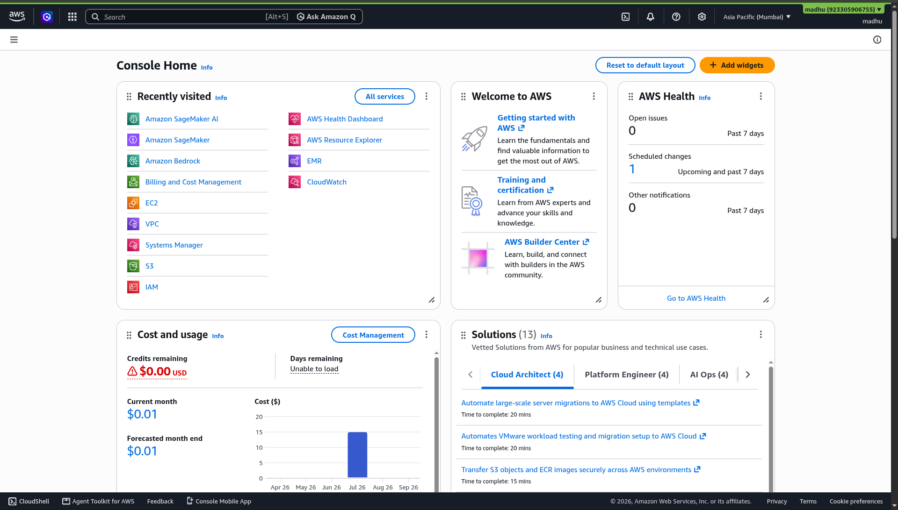

# Chapter 01 — Welcome

  
  &nbsp;&nbsp;&nbsp;
  
    
  <b>AWS Student Builder Group DBIT × PESCE Mandya</b>

> Welcome to the **AWS Cloud Workshop** at PES Mandya. Today you learn how the cloud works, then build real resources in the AWS Console.

---

## 🗓️ Today's Schedule

| Time | Chapter | Type |
|---|---|---|
| 10:45 – 11:00 AM | [02 — Cloud Computing: Before & After](02-cloud-history.md) | 📖 Theory |
| 11:00 – 11:20 AM | [03 — AWS Fundamentals & Service Models](03-aws-fundamentals.md) | 📖 Theory |
| 11:20 – 11:50 AM | [04 — Amazon VPC & Cloud Networking](04-vpc-networking.md) | 📖 Theory + 🖥️ Console walkthrough |
| 11:50 AM – 12:00 PM | [05 — Transition, Q&A & Lab Readiness](05-readiness-check.md) | 💬 Q&A |
| 12:00 – 12:15 PM | [06 — Lab: IAM](06-lab-iam.md) | 🧪 Hands-on lab |
| 12:15 – 12:30 PM | [07 — Lab: S3](07-lab-s3.md) | 🧪 Hands-on lab |
| 12:30 – 01:05 PM | [08 — Lab: EC2 & Security](08-lab-ec2.md) | 🧪 Hands-on lab |
| 01:05 – 01:20 PM | [09 — Builder Center & Well-Architected](09-well-architected.md) | 📖 Theory |
| 01:20 – 01:30 PM | [10 — AWS Academy & AWS SBG Pathways](10-academy-sbg.md) | 🎓 Closing |

---

## 📘 How to Use This Handbook

- Each chapter matches one session. Open the chapter for the current time slot.
- 📖 Theory chapters explain concepts. 🧪 Lab chapters give step-by-step instructions.
- Every chapter ends with a checklist and a link to the next chapter.
- Images are stored in `workshop-resources/images/`.

---

## 🖥️ Your AWS Console

This is what the AWS Management Console looks like once you are logged in. Every lab starts from here.

  
   
  <em>AWS Management Console, the starting point for every lab</em>

---

## 📸 Share the Moment

> 📸 Take a photo of your setup and tag **[@awssbg_dbit](https://www.instagram.com/awssbg_dbit/)** on Instagram with **#AWSBuildersLab**.

---

## ✅ Chapter Checklist

- [ ] Prerequisites from Chapter 00 are complete
- [ ] I know today's schedule
- [ ] I have this handbook open
- [ ] My AWS Console is accessible

---

> ✅ **Ready? Let's begin:**
> ### 👉 [Chapter 02 — Cloud Computing: Before & After the Cloud](02-cloud-history.md)
