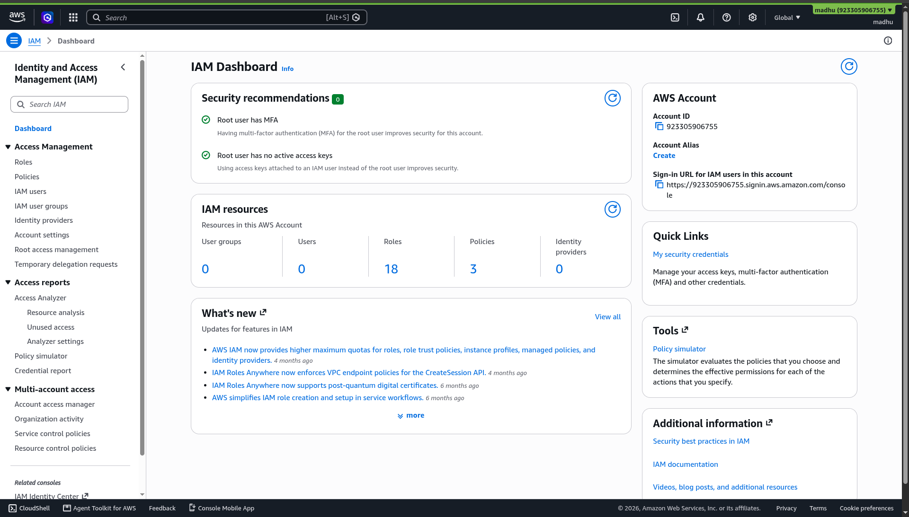
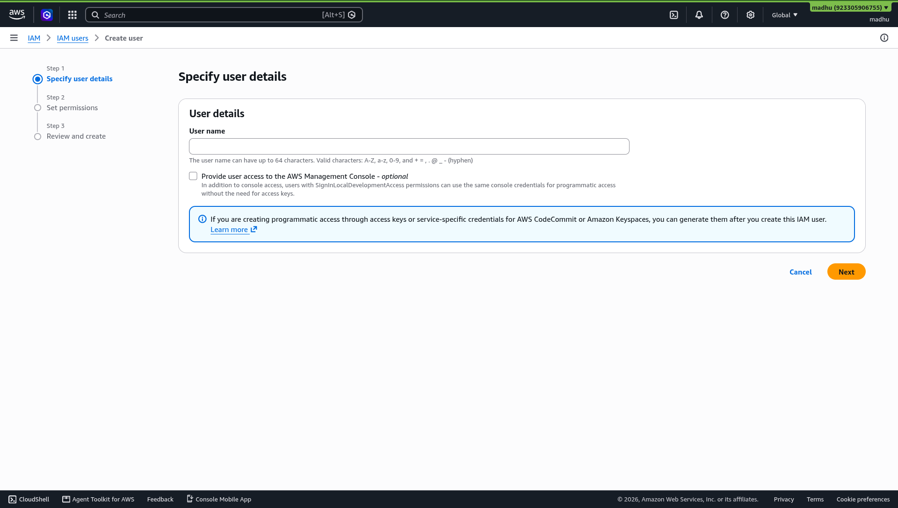
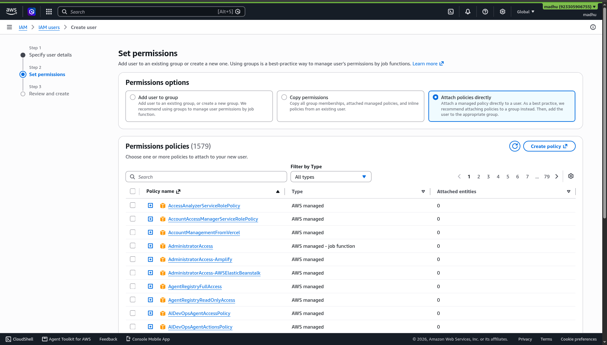

# Chapter 06 — Hands-On Lab: AWS IAM User Setup

> ⏰ 12:00 – 12:15 PM | 🧪 Hands-on lab

**By the end of this chapter you can:**
- Distinguish authentication and authorization
- Explain why you should not use the root account for daily work
- Create an IAM user with AWS Console access and verify the login

---

## 🔐 What Is AWS IAM?

<p align="center">
  
  <br/>
  <b>AWS Identity and Access Management</b>
</p>

IAM controls two things:

- **Authentication:** who can log in to your AWS account
- **Authorization:** what they are allowed to create, view, or delete

Think of it as a digital keycard system. Every person gets their own keycard with exactly the doors they need, no more.

| Term | Meaning |
|---|---|
| **User** | An identity for a person or application |
| **Group** | A collection of users sharing permissions |
| **Role** | An identity with permissions that can be assumed temporarily |
| **Policy** | A JSON document defining permissions |

---

## ❓ Why Not Just Use the Root Account?

```
ROOT ACCOUNT              IAM USER
──────────────────────    ──────────────────────────────
Created at sign-up        Created by you for specific work
Unlimited access          Only the permissions you grant
Includes billing control  No billing access unless granted
NEVER share this          Safe to use for daily tasks
```

> 🥇 **Golden Rule:** Create an IAM user for all hands-on work. Never use the root account for daily tasks.

---

## 👥 RBAC and Least Privilege

- **Role-Based Access Control (RBAC):** give permissions to roles or groups based on job function. Users get access by belonging to them.
- **Principle of Least Privilege:** grant only the permissions needed for a task, and nothing more.

Example of a least-privilege policy (read-only access to one bucket):

```json
{
  "Version": "2012-10-17",
  "Statement": [
    {
      "Effect": "Allow",
      "Action": ["s3:GetObject", "s3:ListBucket"],
      "Resource": [
        "arn:aws:s3:::my-workshop-bucket",
        "arn:aws:s3:::my-workshop-bucket/*"
      ]
    }
  ]
}
```

---

## 👣 Step-by-Step Lab

### Step 1 — Open IAM

```
AWS Console → Search bar → Type: IAM → Click IAM
```

You land on the **IAM Dashboard**. Notice the **Sign-in URL** on the right. Your IAM users use it to log in.

<p align="center">
  
  <br/>
  <em>IAM Dashboard: security recommendations, IAM resources count, and the account Sign-in URL</em>
</p>

---

### Step 2 — Go to Users and Start Creating

```
Left sidebar → Users → Click "Create user" (orange button, top right)
```

You reach the **Specify user details** form (Step 1 of 3 in the wizard).

<p align="center">
  
  <br/>
  <em>Create user wizard, Step 1: enter the username and enable console access</em>
</p>

---

### Step 3 — Enter User Details

```
User name → Enter: workshop-student
✅ Check: "Provide user access to the AWS Management Console"
Password → Select: Custom password
           Enter a strong temporary password
✅ Keep: "Users must create a new password at next sign-in"
→ Click Next
```

---

### Step 4 — Assign Permissions

You are now on **Step 2: Set permissions**.

```
Permissions options → Select: Attach policies directly
Search box → Type: AdministratorAccess
✅ Check the box next to: AdministratorAccess
→ Click Next
```

<p align="center">
  
  <br/>
  <em>Step 2: select "Attach policies directly", then search for and check AdministratorAccess</em>
</p>

> 💡 **AdministratorAccess** grants full permissions. It suits a learning sandbox. In production, always grant the minimum permissions required.

---

### Step 5 — Review and Create

```
Review the User details and Permissions summary
→ Click "Create user"
```

---

### Step 6 — Save the Login Details

```
→ Click "Download .csv file"   ← Do this now
OR copy the Console sign-in URL
```

> ⚠️ This is the **only time** you can download these credentials. Do not skip this step.

---

### Step 7 — Verify the Login Works

```
Open a Private / Incognito browser window
Paste the Console sign-in URL
Enter: username + temporary password → Sign in
Set a new password when prompted
Confirm: you land on the AWS Console dashboard ✅
```

---

## 🌟 Best Practices

- Do not use the root account for daily work
- Enable MFA
- Use roles instead of long-term access keys
- Review permissions regularly

---

## 🌐 Share Your Progress

> 🎉 Just created your first AWS IAM user?
> Share it with the community: **[@awssbg_dbit](https://www.instagram.com/awssbg_dbit/)** with **#AWSBuildersLab #IAM**

---

## ✅ Chapter Checklist

- [ ] IAM user created with Console access
- [ ] AdministratorAccess policy attached
- [ ] Credentials downloaded and saved
- [ ] New user login verified in an incognito window
- [ ] I can explain least privilege in one sentence

---

## 🏆 Badge Unlocked

> ### 🔐 IAM GUARDIAN
> You know how to secure cloud access the right way.

---

> ✅ **Next up:**
> ### 👉 [Chapter 07 — Hands-On Lab: Amazon S3 Static Website](07-lab-s3.md)
