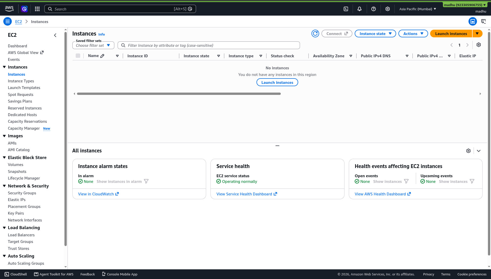
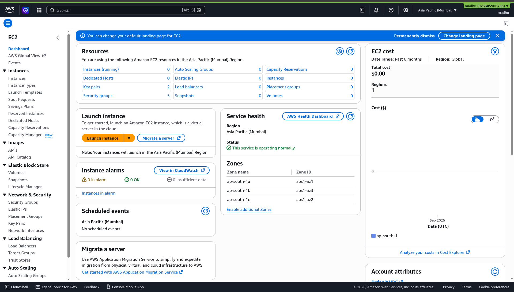
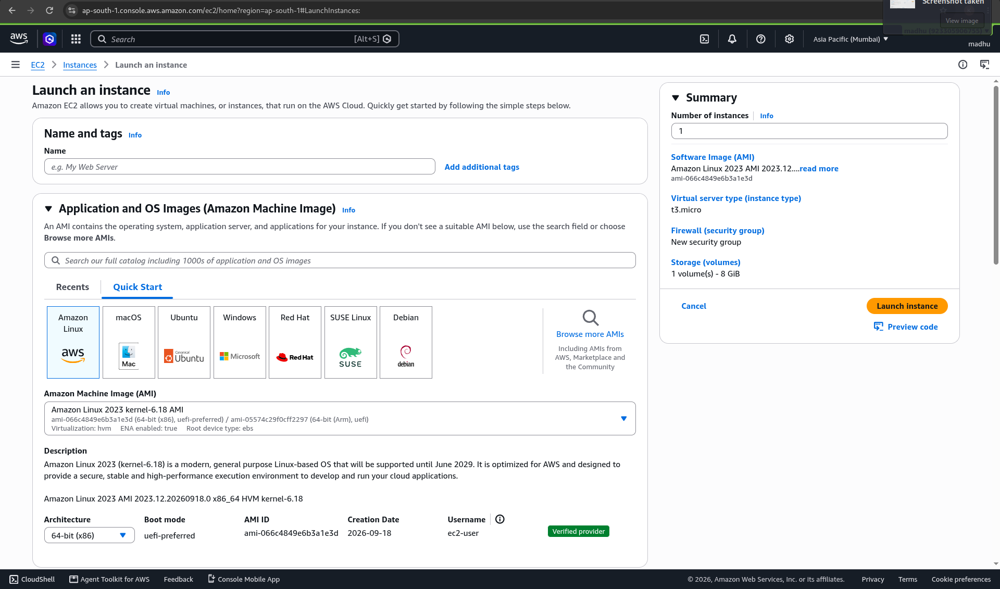
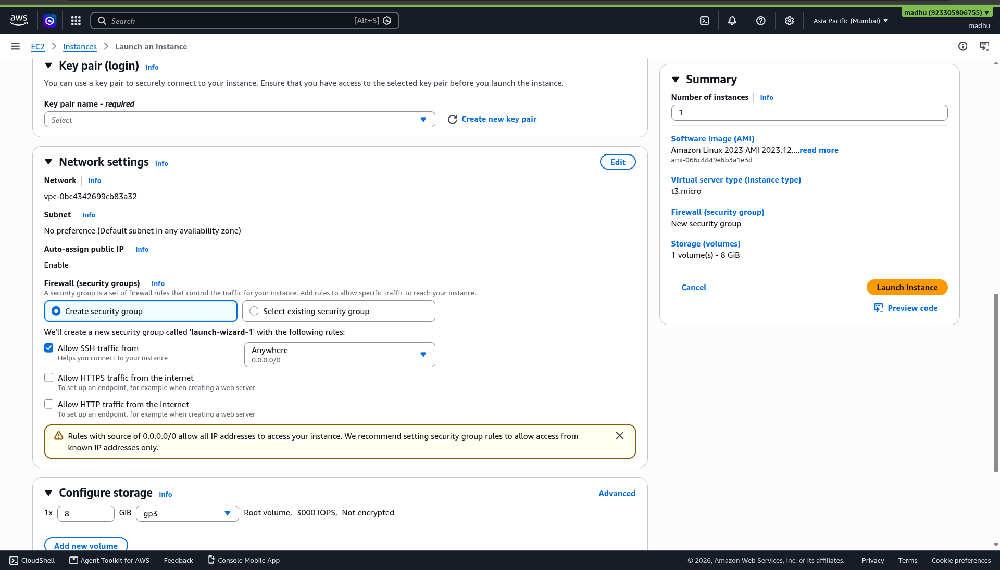
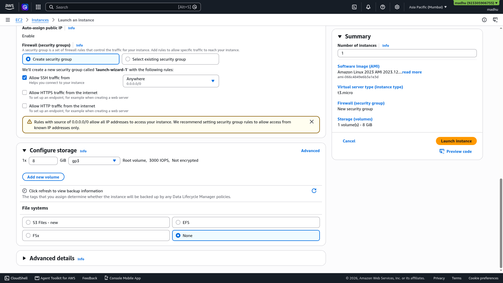

# Chapter 08 — Hands-On Lab: Amazon EC2 & Deploy a React App

> ⏰ 12:30 – 01:05 PM | 🧪 Hands-on lab

**By the end of this chapter you can:**
- Explain virtualization and why it powers the cloud
- Launch an EC2 instance
- Compare Security Groups and Network ACLs
- Deploy a React application on EC2 with Node.js and Nginx

---

## 💻 What Is Amazon EC2?

<p align="center">
  
  <br/>
  <b>Amazon Elastic Compute Cloud</b>
</p>

EC2 gives you virtual machines in the cloud. You pick the operating system and hardware, launch in under a minute, and pay only while it runs.

```
YOUR LAPTOP                   EC2 IN THE CLOUD
───────────────────           ─────────────────────────────
Fixed hardware                Choose any CPU / RAM / storage
One OS                        Any OS: Ubuntu, Windows, Amazon Linux
Always on your desk           Runs in AWS data centers globally
Consumes power 24/7           Pay only when running
```

> ⚙️ **Virtualization is the engine of the cloud.** One physical server runs many isolated virtual machines, so AWS can share hardware efficiently and create servers in minutes.

| Term | Meaning |
|---|---|
| **AMI** | Template with the OS and software for an instance |
| **Instance type** | CPU, memory, and network size, for example `t2.micro` |
| **Key pair** | Credentials for secure login (SSH) |
| **EBS volume** | Block storage attached to an instance |
| **Security group** | Virtual firewall for the instance |

---

## 🛡️ Security Groups vs. NACLs

| Feature | Security Group | Network ACL |
|---|---|---|
| Level | Instance (network interface) | Subnet |
| State | **Stateful** (return traffic automatically allowed) | **Stateless** (return traffic must be allowed explicitly) |
| Rules | Allow only | Allow and deny |
| Evaluation | All rules evaluated | Rules evaluated in number order |
| Default | Denies all inbound | Default NACL allows all |

---

## 🚀 Part A — Launch Your EC2 Instance

### Step 1 — Navigate to EC2

```
AWS Console → Search: EC2 → Click EC2
```

The instances list is empty. That is expected.

<p align="center">
  
  <br/>
  <em>EC2 Instances list: "No instances" is the correct starting state</em>
</p>

From the Dashboard, click **Launch instance** (orange button).

<p align="center">
  
  <br/>
  <em>EC2 Dashboard: click "Launch instance" to start configuring your virtual machine</em>
</p>

---

### Step 2 — Name and OS

```
Name  →  my-first-instance
AMI   →  Ubuntu Server 22.04 LTS (HVM), SSD Volume Type
          Architecture: 64-bit (x86)
```

<p align="center">
  
  <br/>
  <em>Enter a name and select Ubuntu from the Quick Start AMIs</em>
</p>

---

### Step 3 — Instance Type

```
Instance type  →  t2.micro    ✅ Free Tier eligible
```

---

### Step 4 — Key Pair and Network Settings

Scroll down on the same page to reach **Key pair** and **Network settings**.

```
Key pair  →  Click "Create new key pair"
  Key pair name    →  my-workshop-key
  Key pair type    →  RSA
  File format      →  .pem
→ Click "Create key pair"
```

> ⚠️ The `.pem` file downloads automatically. **Save it somewhere safe.** You cannot download it again.

```
Network settings:
✅ Allow SSH traffic from    →  My IP
✅ Allow HTTP traffic from the internet
```

<p align="center">
  
  <br/>
  <em>Key pair (login) and Network settings, further down the same launch form</em>
</p>

---

### Step 5 — Storage and Launch

```
Storage       →  Leave default (8 GiB gp3)
File systems  →  None
```

<p align="center">
  
  <br/>
  <em>Leave storage at the default 8 GiB gp3, then scroll to the bottom and click "Launch instance"</em>
</p>

```
→ Click "Launch instance"
→ Click "View all instances"
```

---

### Step 6 — Wait for the Running State

Wait until **Instance state** shows **Running ✅** and **Status checks** show **2/2 passed**.

> 💡 Refresh the page if the state stays "Pending" for more than a minute.

---

### Step 7 — Look at Your Security Group and NACL

1. Select your instance, open the **Security** tab, and view the inbound rules (SSH 22 from your IP, HTTP 80 from anywhere)
2. Open **VPC → Network ACLs** and view the default NACL rules
3. Compare the two using the table above (allow-only vs. allow/deny, stateful vs. stateless)

---

## 🌐 Part B — Deploy the React App on EC2

You will deploy the workshop React site from **[github.com/kanaka2001/react-application](https://github.com/kanaka2001/react-application)**. It is a Vite + React app. `npm run build` compiles it into a `dist/` folder of static files, and Nginx serves those files.

```
Browser ──► EC2 public IP :80 ──► Nginx ──► /var/www/html (built React files)
```

### Step 1 — Connect via SSH

Open your terminal in the folder where the `.pem` file was saved:

```bash
chmod 400 my-workshop-key.pem
ssh -i my-workshop-key.pem ubuntu@<YOUR-EC2-PUBLIC-IP>
```

Replace `<YOUR-EC2-PUBLIC-IP>` with the **Public IPv4 address** shown in the EC2 console.

> 💡 **Finding the IP:** EC2 Console → Instances → click your instance → copy **Public IPv4 address**.
>
> 🪟 **Windows:** use PowerShell or Windows Terminal (OpenSSH is built in), or use **Connect → EC2 Instance Connect** in the console, which needs no `.pem` file.

---

### Step 2 — Update the System

```bash
sudo apt update && sudo apt upgrade -y
```

---

### Step 3 — Install Node.js

```bash
# Add the NodeSource repository for Node.js 20
curl -fsSL https://deb.nodesource.com/setup_20.x | sudo -E bash -

# Install Node.js (npm is included)
sudo apt install -y nodejs
```

Verify the installation:

```bash
node -v    # Expected: v20.x.x
npm -v     # Expected: 10.x.x
```

---

### Step 4 — Install Git and Clone the Repository

```bash
sudo apt install -y git

git clone https://github.com/kanaka2001/react-application.git
cd react-application
```

---

### Step 5 — Install Dependencies and Build

```bash
# Install the packages listed in package.json
npm install

# Compile the app. This creates the dist/ folder
npm run build
```

> 💡 `dist/` holds the production-ready static files: HTML, CSS, and JavaScript, bundled and optimised.

> 🛠️ **If the build stops with "Killed" or an out-of-memory error:** a `t2.micro` has only 1 GB of RAM. Add temporary swap space and run the build again:
> ```bash
> sudo fallocate -l 1G /swapfile
> sudo chmod 600 /swapfile
> sudo mkswap /swapfile
> sudo swapon /swapfile
> npm run build
> ```

---

### Step 6 — Install Nginx and Deploy

```bash
# Install the Nginx web server
sudo apt install -y nginx

# Replace the default page with your built files
sudo rm -rf /var/www/html/*
sudo cp -r dist/* /var/www/html/

# Start Nginx and enable it on boot
sudo systemctl start nginx
sudo systemctl enable nginx
```

Check that Nginx is running:

```bash
sudo systemctl status nginx    # Press q to exit
```

---

### Step 7 — Open the App in a Browser

```
http://<your-ec2-public-ip>
```

Your React site is now live, served from your own EC2 instance. 🎉

> ⚠️ Use **http://**, not https://. Your browser may switch to https automatically. If the page does not load, retype the address with `http://`.

---

### 🛠️ Troubleshooting

| Problem | Likely cause and fix |
|---|---|
| `Permission denied (publickey)` on SSH | Wrong `.pem` file, or the username is not `ubuntu`. Run `chmod 400` on the key |
| SSH times out | Your IP changed. Edit the security group's SSH rule and set **My IP** again |
| Browser times out on the public IP | The security group has no HTTP (80) rule. Add an inbound rule: HTTP, port 80, source `0.0.0.0/0` |
| Browser shows the Nginx welcome page | The files were not copied. Repeat Step 6 and check that `dist/` exists |
| `npm run build` is killed | Out of memory. Add swap space as shown in Step 5 |
| Public IP changed after a stop and start | EC2 assigns a new public IP each time. Read the new one in the console |

---

## 🧹 Clean-Up — Do Not Skip This

EC2 charges by the hour. Terminate the instance when you finish the lab:

```
EC2 → Instances → Select your instance
→ Instance state → Terminate instance → Confirm
```

> **Terminated** = permanently deleted, and charges stop.
> **Stopped** = paused, but storage still charges.

---

## 🌐 Celebrate This Moment

> 💻 You just deployed a React app on an AWS EC2 server!
> Share it with **[@awssbg_dbit](https://www.instagram.com/awssbg_dbit/)** on Instagram.
> **#AWSBuildersLab #EC2 #ReactJS #CloudComputing**

---

## ✅ Chapter Checklist

- [ ] EC2 instance launched with Ubuntu 22.04 on `t2.micro`
- [ ] Key pair downloaded and saved
- [ ] Instance reached Running state with 2/2 checks passed
- [ ] Reviewed the security group and the default NACL
- [ ] Connected over SSH
- [ ] Node.js 20 installed and the repository cloned
- [ ] `npm run build` created the `dist/` folder
- [ ] Nginx installed and the app visible at `http://<public-ip>`
- [ ] Instance terminated after the lab

---

## 🏆 Badge Unlocked

> ### 💻 CLOUD ENGINEER
> You launched a VM, installed a web stack, and deployed a real React app.

---

> ✅ **Next up:**
> ### 👉 [Chapter 09 — AWS Builder Center & Well-Architected Framework](09-well-architected.md)
