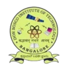

# Chapter 10 — AWS Academy & AWS SBG Pathways

> ⏰ 01:20 – 01:30 PM | 🎓 Closing

---

## 🎓 AWS Academy

- Structured learning paths and courses delivered through educational institutions
- Builds foundational and role-based cloud skills
- Supports preparation for AWS certifications

> 🛠️ **To be added by the facilitators:** how to enroll through PES Mandya and the course names.

---

## 🤝 AWS Student Builder Group (SBG)

  
  &nbsp;&nbsp;
  

**AWS Student Builder Group (SBG)** is a student-driven cloud community. It:

- Organizes hands-on workshops and technical events
- Connects students with AWS learning resources and career opportunities
- Builds peer learning through collaboration
- Helps students build real skills for internships and placements

---

## 🚪 How to Join the Student Builder Group

### 1️⃣ Join the Official Meetup Group (Do This First)

Meetup is where the group publishes official events and registrations. **Joining the Meetup group is the main way to become part of the community.**

  <a href="https://www.meetup.com/aws-sbg-at-don-bosco-institute-of-technology-bangalore/"><b>🤝 Join the AWS SBG Meetup Group</b></a>

1. Open the Meetup link above
2. Create a Meetup account, or log in
3. Click **Join this group**
4. Answer the membership questions, if asked
5. Watch for upcoming events and RSVP to the ones you want to attend

### 2️⃣ Follow Our Social Channels

| Platform | What you get | Link |
|:---:|---|:---:|
| 🤝 **Meetup** | Official events and RSVPs | [Join](https://www.meetup.com/aws-sbg-at-don-bosco-institute-of-technology-bangalore/) |
| 📢 **WhatsApp Channel** | Updates, resources, and event news | [Join](https://whatsapp.com/channel/0029Vb76rEYATRSlFR1mOg2X) |
| 📸 **Instagram** | Workshop highlights, tips, community posts | [@awssbg_dbit](https://www.instagram.com/awssbg_dbit/) |
| 💼 **LinkedIn** | Career opportunities and professional updates | [AWS SBG DBIT](https://www.linkedin.com/company/aws-sbg-dbit/) |
| 📘 **Facebook** | Community posts and event announcements | [Follow](https://www.facebook.com/awssbg.dbit) |
| ✖️ **X (Twitter)** | Quick updates and AWS news | [@awssbg_dbit](https://x.com/awssbg_dbit) |
| 🌐 **Website** | All events and registration | [awsevents.dbit.edu.in](https://awsevents.dbit.edu.in/) |

### 3️⃣ Sign Up on AWS Builder Center

Use the workshop link **[https://bit.ly/450cFtS](https://bit.ly/450cFtS)** to unlock the student rewards from [Chapter 09](09-well-architected.md).

  

---

## 🚀 Your Next Steps

| When | Action |
|---|---|
| **Today** | Join the Meetup group and the WhatsApp channel |
| **Today** | Finish your Builder Center sign-up and start student verification |
| **This week** | Repeat the IAM, S3, and EC2 labs on your own |
| **This week** | Start the Cloud Practitioner learning path on [AWS Skill Builder](https://skillbuilder.aws) |
| **This month** | Earn Builder Center badges toward the credits and exam voucher |
| **Next** | Work toward the AWS Certified Cloud Practitioner exam |

Useful links:

| Resource | Link |
|---|---|
| AWS Builder Center | https://builder.aws.com |
| AWS Skill Builder | https://skillbuilder.aws |
| AWS Certifications | https://aws.amazon.com/certification |
| AWS Free Tier | https://aws.amazon.com/free |
| AWS Console | https://console.aws.amazon.com |

---

## ✅ Chapter Checklist

- [ ] Joined the AWS SBG Meetup group
- [ ] Joined the WhatsApp channel
- [ ] Following us on Instagram, LinkedIn, Facebook, and X
- [ ] Signed up on AWS Builder Center
- [ ] Noted my next learning step

---

## 🙏 Closing Remarks

Thank you for taking part. The workshop ends here. The learning, and the rewards, continue.

---

> 📚 **Need a quick reference?**
> ### 👉 [Chapter 11 — Glossary](11-glossary.md)
